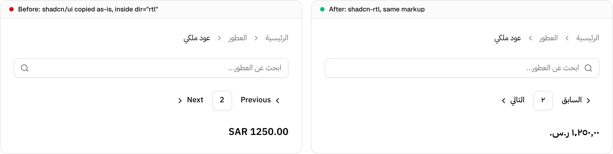
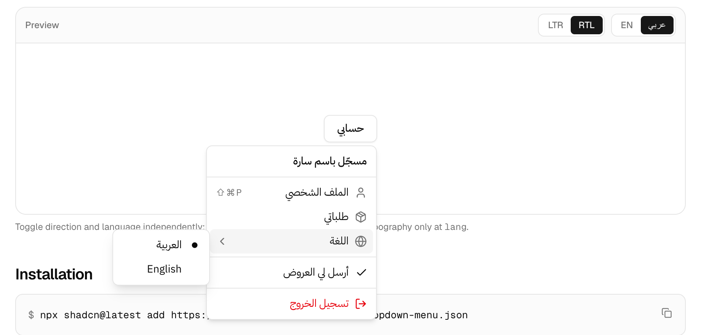

# shadcn-rtl

RTL- and Arabic-ready components for [shadcn/ui](https://ui.shadcn.com), distributed as a shadcn registry.

**Demo and docs:** https://shadcn-rtl.vercel.app



## Why

Most shadcn/ui components quietly assume left-to-right: `ml-*`, `left-*`, `space-x-*`, `text-left`, chevrons that point right and sheets that slide in from the left. Put them in an Arabic store and breadcrumbs point backwards, icons sit on the wrong side of inputs, submenus open off-screen and prices come out as "SAR 1250.00".

shadcn-rtl gives you drop-in versions of those components, written with logical properties (`ms-/me-/ps-/pe-/start-/end-`), `rtl:` variants for icons that must flip and direction-aware animations. It also ships the Arabic pieces shadcn/ui has no equivalent for: typography, prices with the right digits and currency placement, and Hijri dates.

The components follow upstream closely, so the diff against shadcn/ui stays small and easy to review. Every docs page lists exactly what changed.



## Components

| Item | What it fixes or adds |
| --- | --- |
| [`direction-provider`](https://shadcn-rtl.vercel.app/docs/direction-provider) | DirectionProvider + useDirection(): sets dir/lang, feeds Radix's DirectionProvider, optional `<html>` sync |
| [`arabic-typography`](https://shadcn-rtl.vercel.app/docs/arabic-typography) | Arabic font stack (IBM Plex Sans Arabic, Noto Kufi Arabic), taller line-heights, no letter-spacing on Arabic |
| [`breadcrumb`](https://shadcn-rtl.vercel.app/docs/breadcrumb) | Separator chevron points the reading way; localisable ellipsis label |
| [`pagination`](https://shadcn-rtl.vercel.app/docs/pagination) | Mirrored chevrons, logical padding, localisable Previous / Next |
| [`sheet`](https://shadcn-rtl.vercel.app/docs/sheet) | `side="start" | "end"` that open and slide from the correct edge; dir carried into the portal |
| [`dropdown-menu`](https://shadcn-rtl.vercel.app/docs/dropdown-menu) | Submenus open to the inline end, mirrored chevron, logical indicator and inset padding, shortcuts not reversed |
| [`carousel`](https://shadcn-rtl.vercel.app/docs/carousel) | Embla `direction` from the provider, mirrored arrows, swapped arrow keys, logical gutters |
| [`select`](https://shadcn-rtl.vercel.app/docs/select) | Check indicator and item padding on logical sides |
| [`dialog`](https://shadcn-rtl.vercel.app/docs/dialog) | Close button at the inline end, `text-start` header, dir carried into the portal |
| [`input`](https://shadcn-rtl.vercel.app/docs/input) | `startIcon` / `endIcon` slots positioned with logical properties |
| [`tabs`](https://shadcn-rtl.vercel.app/docs/tabs) | Keyboard navigation and vertical line indicator follow the direction |
| [`price`](https://shadcn-rtl.vercel.app/docs/price) | `Price` / `NumberDisplay` on Intl.NumberFormat: ar-SA / en, Arabic-Indic or Latin digits, SAR / AED / any currency, compare-at price |
| [`hijri-date`](https://shadcn-rtl.vercel.app/docs/hijri-date) | `<time>` in the Umm al-Qura Hijri calendar, optional Gregorian date, Gregorian fallback |

## Install

Each item is a normal shadcn registry item. Run the command in a project that already has shadcn/ui set up (`npx shadcn@latest init`). The CLI copies the source into your project, so you own it. Upstream dependencies such as `button` come from the official shadcn/ui registry.

```bash
npx shadcn@latest add https://shadcn-rtl.vercel.app/r/direction-provider.json
npx shadcn@latest add https://shadcn-rtl.vercel.app/r/arabic-typography.json
npx shadcn@latest add https://shadcn-rtl.vercel.app/r/breadcrumb.json
npx shadcn@latest add https://shadcn-rtl.vercel.app/r/pagination.json
npx shadcn@latest add https://shadcn-rtl.vercel.app/r/sheet.json
npx shadcn@latest add https://shadcn-rtl.vercel.app/r/dropdown-menu.json
npx shadcn@latest add https://shadcn-rtl.vercel.app/r/carousel.json
npx shadcn@latest add https://shadcn-rtl.vercel.app/r/select.json
npx shadcn@latest add https://shadcn-rtl.vercel.app/r/dialog.json
npx shadcn@latest add https://shadcn-rtl.vercel.app/r/input.json
npx shadcn@latest add https://shadcn-rtl.vercel.app/r/tabs.json
npx shadcn@latest add https://shadcn-rtl.vercel.app/r/price.json
npx shadcn@latest add https://shadcn-rtl.vercel.app/r/hijri-date.json
```

Installing `dialog`, `sheet`, `select`, etc. overwrites the upstream file of the same name in `components/ui` (the CLI asks first). The API is the same, plus a few optional props for localised labels.

### Set the direction

Put the provider at the root and sync `<html>`, so portalled content (dialogs, sheets, menus) and the scrollbar follow:

```tsx
import { DirectionProvider } from "@/components/ui/direction-provider"

<html lang="ar" dir="rtl">
  <body>
    <DirectionProvider dir="rtl" lang="ar" asWrapper={false}>
      {children}
    </DirectionProvider>
  </body>
</html>
```

The components read the direction from Radix's context, so they also work under Radix's own `Direction.Provider`.

### Arabic typography

`arabic-typography` adds `font-arabic` / `font-arabic-heading` and base styles to your CSS. Load the fonts yourself, for example with `next/font/google`:

```tsx
import { IBM_Plex_Sans_Arabic, Noto_Kufi_Arabic } from "next/font/google"

const plexArabic = IBM_Plex_Sans_Arabic({
  subsets: ["arabic"],
  weight: ["400", "500", "600", "700"],
  variable: "--font-ibm-plex-sans-arabic",
})
const kufi = Noto_Kufi_Arabic({ subsets: ["arabic"], variable: "--font-noto-kufi-arabic" })
```

Without Next.js, add the Google Fonts `<link>` printed by the CLI after install.

### Prices and dates

```tsx
<Price amount={1250} />                                   // ١٬٢٥٠٫٠٠ ر.س.
<Price amount={1250} currency="AED" locale="ar-AE" />     // 1,250.00 د.إ.
<Price amount={1250} locale="en" compareAt={1490} />     // SAR 1,250.00  ~~SAR 1,490.00~~
<Price amount={1250} digits="latn" />                     // 1,250.00 ر.س.
<HijriDate date={order.createdAt} show="both" />          // ١٣ جمادى الآخرة ١٤٤٨ هـ  ٢٣ نوفمبر ٢٠٢٦
```

`formatPrice`, `formatNumber`, `formatHijri` and `formatGregorian` are exported from `lib/format-number.ts` and `lib/format-date.ts` for places that need a string.

## Development

```bash
pnpm install
pnpm dev              # demo on http://localhost:3000
pnpm registry:build   # registry.json -> public/r/*.json
pnpm build            # registry + site
```

Stack: Next.js 16 (App Router), Tailwind CSS 4, Radix UI, shadcn CLI 4. See [CONTRIBUTING.md](CONTRIBUTING.md).

## Credits

Built by **Zuanda Baransyah Putra** — https://zuanda.web.id

Builds on [shadcn/ui](https://github.com/shadcn-ui/ui) (MIT) and [Radix UI](https://www.radix-ui.com). Released under the [MIT License](LICENSE).
